<p align="center"> </p>

# FixIt

Snap a photo of something broken at home. FixIt checks for an emergency, suggests a safe next step, and drafts a request to your landlord—nothing is sent until you approve it.

[**Live app ↗**](https://mmhack.vercel.app) · [**Anbaric mirror (sign-in) ↗**](https://fixit.cloud.anbaric.ai) · [**ADRs**](docs/adr/)

Built by Luigi Canoro at the Multi Model Hackathon · #SFTechWeek · October 11, 2026.


## Try it now

**Zero install, no signup:** open [mmhack.vercel.app](https://mmhack.vercel.app) and choose **Continue as guest**.

1. **Show the problem.** Upload a photo and add a sentence about what’s broken.
2. **Confirm what FixIt sees.** Tap the confirmation chips and answer one or two clarifying questions.
3. **Review your next step.** Read the safe plan and cross-check, or emergency guidance if a hazard is detected. Review the landlord request before approving any action.

**Guests get drafts only.** Sending email requires sign-in and **Connect Gmail**, followed by your approval.

The [Anbaric mirror](https://fixit.cloud.anbaric.ai) requires Anbaric sign-in.


## Feature tour

### Photo read → tap to confirm

FixIt starts with a one-line read of your photo, then uses tap chips to confirm the problem before asking follow-up questions.

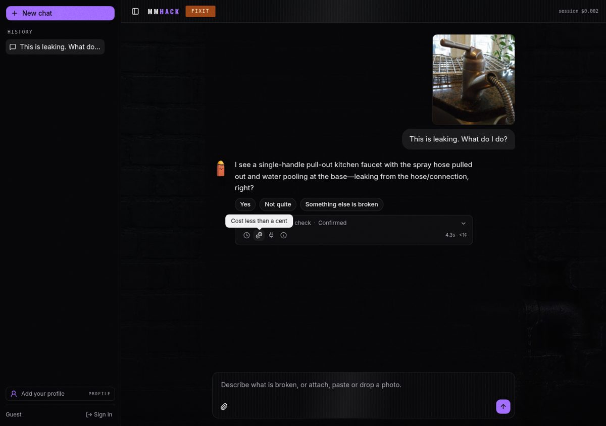

### A short plan, with the routing visible

Every turn includes an inline trace: **task, model, why, latency, and estimated cost** when token usage is reported. **Why this model?** opens the architecture decision record behind the choice.

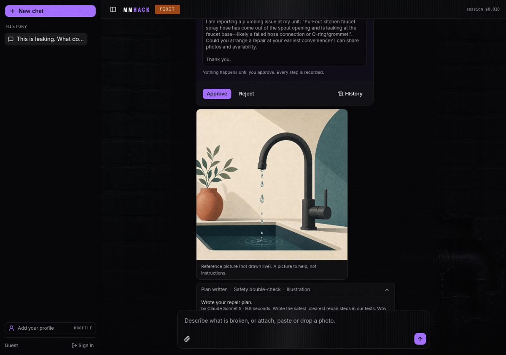

### Safety comes before DIY

Hazard checks combine deterministic text rules, model triage, and the photo’s hazard flag. A detected hazard triggers a **Safety stop**: no DIY steps, emergency guidance, and only a landlord-request draft as the continuation.

<table>
  <tr>
    <td>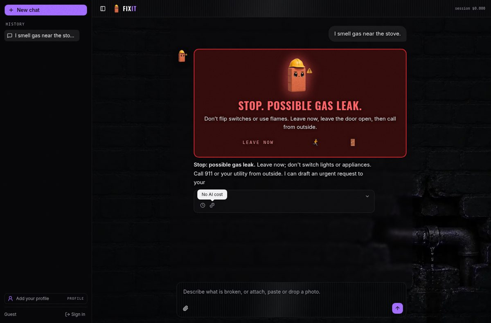</td>
    <td></td>
  </tr>
</table>

### The safety stop on mobile

The emergency flow also appears in the mobile experience.

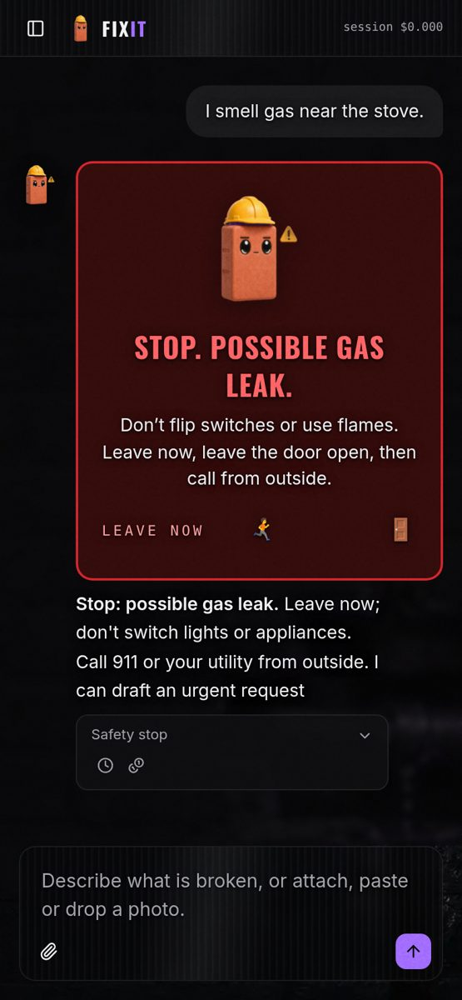

### Your draft. Your approval.

Review the landlord request on an approval card. Approval is tied to the exact draft and session; editing the draft invalidates that approval.

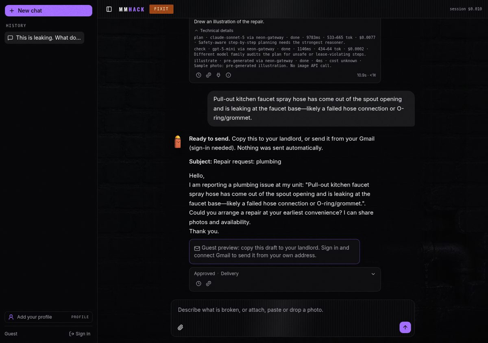

### An audit trail you can open

The **Audit** drawer shows the job timeline with **HUMAN / AGENT / CODE** actors. The workflow uses Anbaric State/Transition contracts; demo persistence is local JSON with a signed job snapshot, not cloud sync.


### Send from your Gmail

Signed-in users can connect Gmail through Composio and send the approved request from their account. Profile shows the connected address and supports disconnecting. Guests keep the draft without sending.

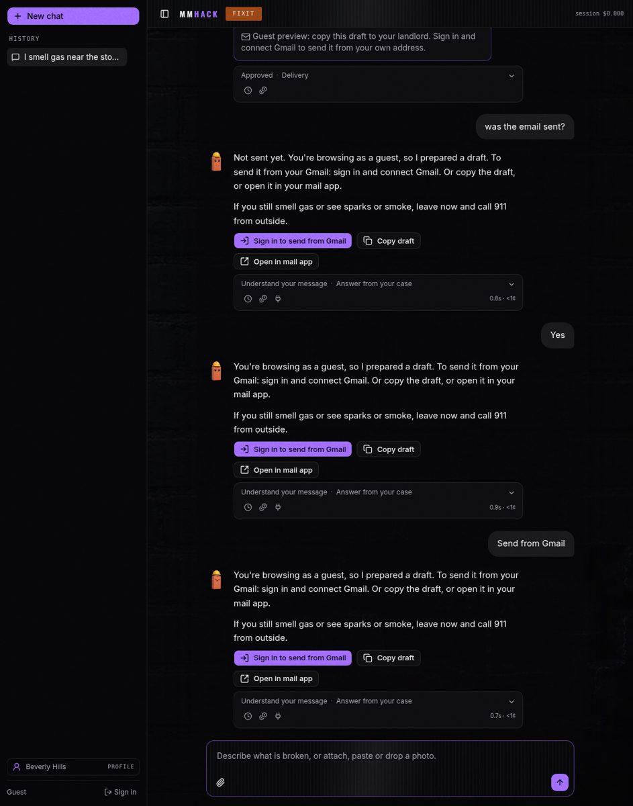

### Recommended pros + pricing

A **Recommended pros near you** card appears in chat, alongside dedicated `/pros` signup and `/pricing` pages. In this v0, **Request visit** needs an explicit approve step and then only prepares a draft: the listed pros are demo entries with no contact details, and no ratings or reviews are shown because we have none. Real booking is on the roadmap.

<table>
  <tr>
    <td>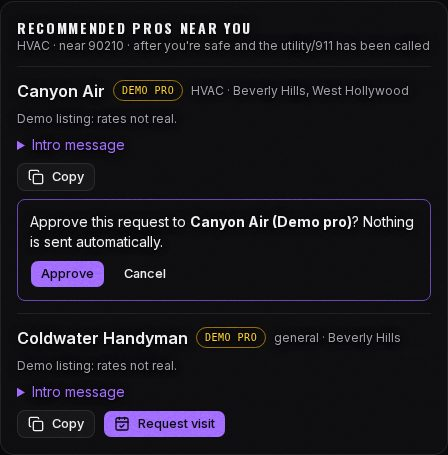</td>
    <td>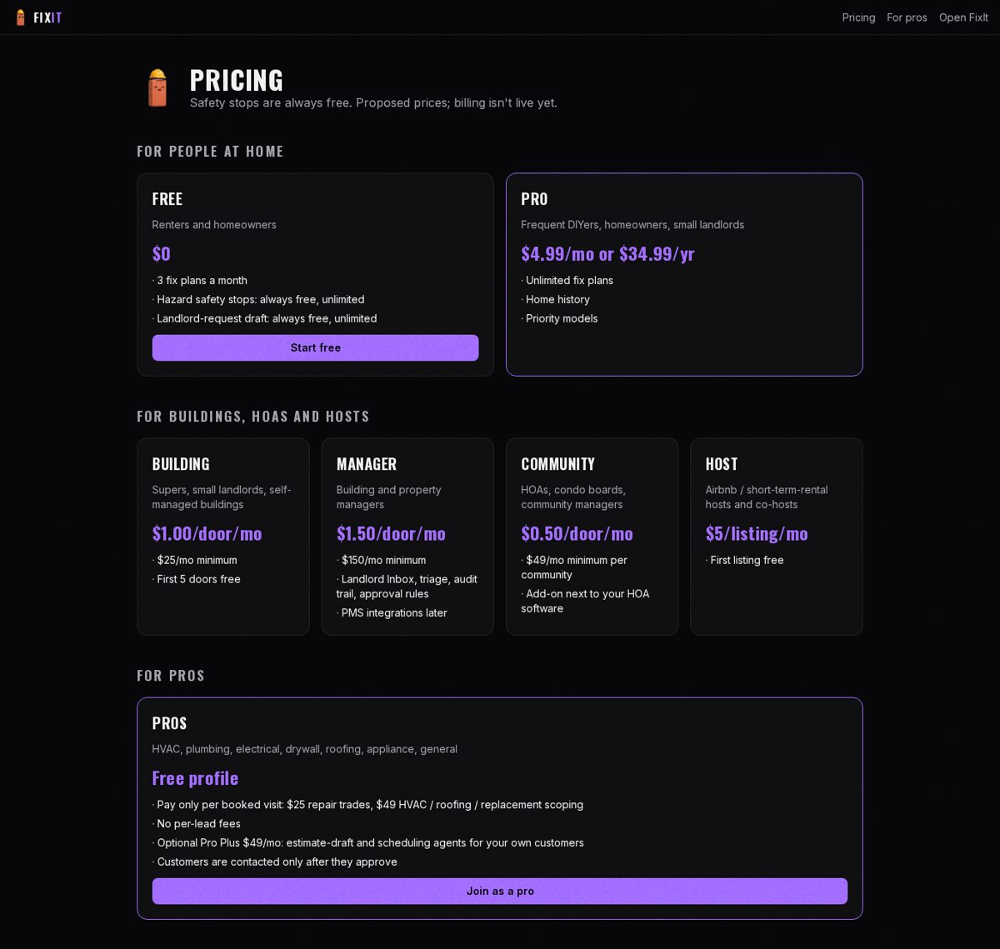</td>
  </tr>
</table>

### Mobile, with room to read

Text reveals at roughly **400 words per minute**, with cards held until the text is read. Skip the pacing whenever you like; reduced-motion mode shows everything at once.

<table>
  <tr>
    <td>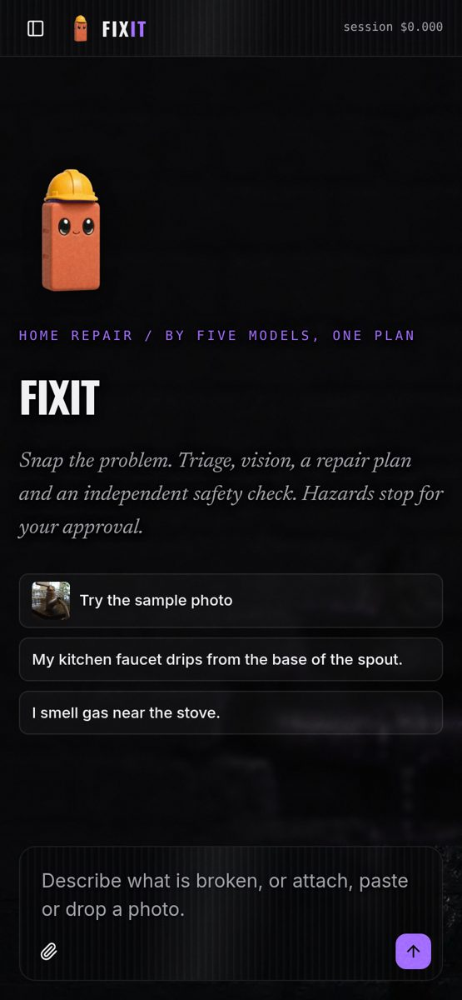</td>
    <td>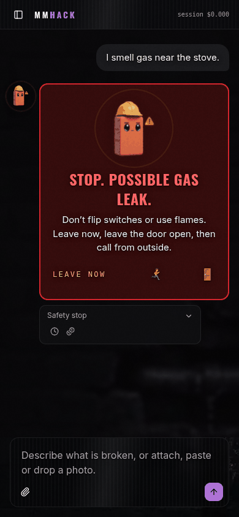</td>
  </tr>
</table>

### Start as a guest

Choose **Continue as guest** to try the photo-to-draft flow without creating an account.

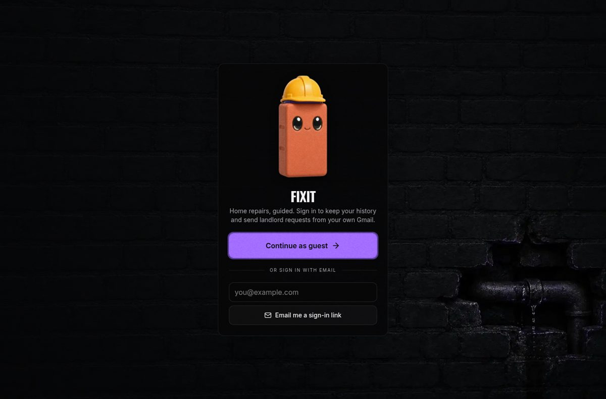

## Architecture

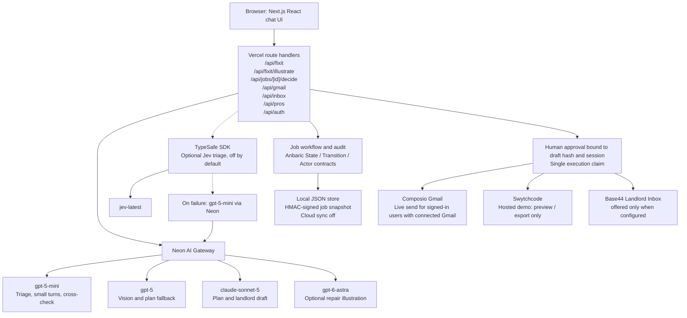

Neon routes the default model pipeline, including image generation; optional raw Jev uses the TypeSafe SDK, is off by default, and has not been benchmarked. Anbaric contracts model the workflow and audit trail, but demo persistence is local JSON in `/tmp`, not durable cloud storage. Composio Gmail is the live email path for connected, signed-in users; guests receive drafts, hosted Swytchcode remains preview/export-only, and the Base44 inbox card is offered only when Base44 is configured, and live production delivery is not verified.

### Request flow

```mermaid
sequenceDiagram
    actor User
    participant UI as Browser chat
    participant API as Vercel API
    participant Gateway as Neon AI Gateway
    participant Jobs as Job store and audit
    participant Outbound as Approved delivery adapter

    User->>UI: Upload photo and describe the problem
    UI->>API: Submit case
    API->>API: Check quotas, body size, and image limits
    API->>API: Evaluate deterministic hazard regex
    Note over API: Hazard text never receives a quota refusal

    par Photo reading
        API->>Gateway: gpt-5 vision
        Gateway-->>API: Photo read and HAZARD flag
    and Text triage
        API->>Gateway: gpt-5-mini triage
        Gateway-->>API: Triage and hazard flag
    end
    Note over API: Both calls start together; the text triage verdict is checked first, then the photo's HAZARD line

    alt Any hazard signal
        API-->>UI: Safety stop and emergency guidance, no DIY steps
        UI-->>User: Only continuation is a landlord request draft
    else No hazard signal
        API-->>UI: Photo read and confirmation chips
        User->>UI: Confirm and answer clarifying questions
        UI->>API: Clarified case
        API->>Gateway: claude-sonnet-5 plan and landlord draft
        alt Planner succeeds
            Gateway-->>API: Plan and draft
        else Planner fails or times out
            API->>Gateway: Retry with gpt-5
            Gateway-->>API: Fallback plan and draft
        end
        API->>API: Apply post-plan safety filter
        API->>Gateway: gpt-5-mini cross-check
        Gateway-->>API: Cross-check result
        API-->>UI: Safe plan and landlord request option
    end

    opt User chooses a landlord request
        API->>Jobs: Store draft hash and awaiting_approval state
        API-->>UI: Show approval card with exact draft
        User->>UI: Approve draft
        UI->>API: Submit approval
        API->>Jobs: Validate session and draft hash
        Jobs-->>API: Record human approval
        API->>Jobs: claimExecution
        Jobs-->>API: Grant single execution claim
        API->>Outbound: Export draft or send once if configured
        Outbound-->>API: Delivery or export status
        API->>Jobs: Record action and outcome in audit
        API-->>UI: Show result and audit timeline
    end
```

Hazard signals from the regex, triage model, or photo reading stop the DIY path; illustration generation is also skipped for hazards. Approval is tied to the exact draft and session, so editing the draft invalidates approval. Execution uses a single claim and adapter-specific idempotency safeguards, with ambiguous send results left unknown rather than retried; the demo’s instance-local stores are not durable across instances.

## Multi-model routing

One model isn't enough: spotting a hazard, reading a photo, and writing a safe repair plan are different jobs. FixIt routes each step to a model chosen for that task. Every model call in the default pipeline goes through **Neon AI Gateway**, including image generation. The optional raw Jev adapter is a separate, opt-in path.

The source of truth is [`src/app/api/fixit/route.ts`](src/app/api/fixit/route.ts) and **ADR-002** in [`docs/adr/`](docs/adr/)—not the older generic router in `src/lib/router.ts`.

| Step | Model | Bake-off result (quality · median latency · $/call) | Why this model |
| --- | --- | --- | --- |
| Triage | `gpt-5-mini` | 4/5 correct · 1.7s · $0.00007 | Caught every gas/electrical stop in the small test set at roughly 1/7 of Sonnet’s cost. |
| Vision | `gpt-5` (`reasoningEffort: low`) | 8.0/10 · 3.6s · $0.0025 | About 96% of Opus’s score at 1/5 the cost and 2× faster. Its `HAZARD: yes/no` output also gates the plan. |
| Plan + landlord draft | `claude-sonnet-5`; automatic `gpt-5` retry | **Tested `sonnet-5-5`:** 8.7/10 · 5.7s · $0.0061 | About 96% of `gpt-6-astra`’s score at 1/3 the cost and 1.7× faster. The gateway serves `claude-sonnet-5`, **not the benchmarked `5-5` variant**. Planner timeout: 45s; retry: 90s, traced as `plan-fallback`. |
| Cross-check | `gpt-5-mini` | 3/3 planted errors caught · 1.9s · $0.0003 | A low-cost check from a different provider family than the primary planner. |
| Small conversational turns | `gpt-5-mini` | Not benchmarked separately | Handles confirmation, reply understanding, intent routing, and quick replies. |
| Optional repair illustration | `gpt-6-astra` | 10/10 · 24.9s (n=1) · image charge **not measured** | Top score and fastest of the image-capable models (gpt-5-5-pro also scored 10, at 29.6s). Runs asynchronously; skipped for hazards or when there is no photo. |
| Optional Jev triage | Raw `jev-latest` via TypeSafe SDK | **Raw Jev not benchmarked.** OpenRouter `typesafe/jev-router`: 4/5 · 1.7s · cost not reported | Opt-in alternative, **off by default**. Falls back to `gpt-5-mini` on timeout, error, malformed output, or a low-confidence non-hazard answer; a low-confidence answer with P(hazard) ≥ 0.3 is treated as a hazard instead. |

### Tested and cut

- **`grok-4-6`:** Won no task, ran 3–10× slower, and returned empty output at shared token caps.
- **Opus:** Not a default. On vision, its 8.3/10 score versus GPT-5’s 8.0/10 came at roughly 5× the cost and twice the latency.

**Routed vs single model:** ~$0.009 / ~13s per run versus all-Opus at ~$0.038 / ~22s—about 4× cheaper.

> **Directional, small sample:** The bake-off ran on **Oct 11, 2026, ~9:45–10:05 AM PT**, with **n=3–5 per task** (image **n=1**) and blind judging by `gemini-3-1-pro`. These results are not statistically significant; image charges were not measured. See [`JUSTIFICATION.md`](JUSTIFICATION.md) and the scripts and scores in [`bake/`](bake/).

## Safety design

### Hazard gate

Three signals can trigger a **Safety stop**:

1. **Deterministic text check:** the `HAZARD` regex in `src/app/api/fixit/route.ts`.
2. **Triage:** the model’s hazard flag.
3. **Vision:** the photo read’s `HAZARD: yes/no` line. A photo-only hazard also stops the plan.

The text rule, verbatim from `route.ts` (English and Spanish triggers):

```ts
const HAZARD = /\b(gas|spark|sparking|sparks|burning|smoke|shock|exposed wire|carbon monoxide|flood(ing)?|sewage|sagging|chispa|humo|olor a gas|fuga de gas|cortocircuito)\b/i;
```

A hazard stops DIY instructions and shows emergency guidance—for example, a red **“Stop. Possible gas leak.”** banner (rendered uppercase) with a **“Leave now”** evacuation card (`src/components/chat/evac-card.tsx`). The only continuation is a landlord request draft. Repair illustrations are skipped for hazards, and a post-plan safety filter replaces DIY steps on gas/electrical hazards.

**Hazard text never gets a quota refusal.**

### Approval gate

The job lifecycle uses Anbaric `State`/`Transition` contracts in `src/lib/jobs/workflow.ts`:

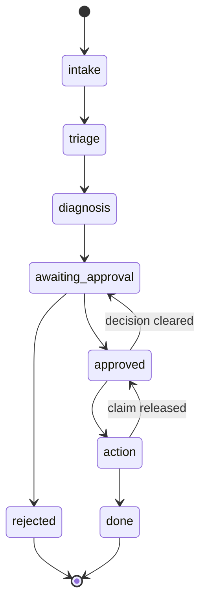

- **Approval is bound to the session and SHA-256 draft hash.** Editing the draft invalidates approval.
- **Job tokens are HMAC-signed** by `sealJob`, with `FIXIT_JOB_SECRET` (or, if unset, a key derived server-side from the gateway token).
- **Execution has a single claim** through `claimExecution`.
- **The Audit drawer records actors:** `HUMAN`, `AGENT`, `CODE`, and `SYSTEM`.

The Swytchcode approval card previews the exact payload without side effects. For that send path, recipient and sender are pinned to `LANDLORD_EMAIL` and `FIXIT_FROM_EMAIL`, never model output. Report text is stripped of links and Markdown before email.

Nothing is sent until you approve it.

### Idempotency

Each outbound path has its own duplicate-send guard:

| Path | Guard |
| --- | --- |
| **Swytchcode** | Hashes the job ID plus the canonical payload (action, tool, mode, from, to, subject, body). Uses an exclusive record file (`wx`) per instance and a provider `Idempotency-Key` header. |
| **Gmail / Composio** | Allows one send per `(user, approval key)`. Reserves the send before execution; an unknown result keeps the reservation. |
| **Base44** | Uses `sha256(session:draftHash)` to identify an approved draft delivery. Tracks delivery states, including `unknown` and `export_only`. |

Swytchcode key construction (`src/lib/actions/governed.ts`):

```ts
export const canonical = (o: Outbound) => JSON.stringify({ action: o.action, tool: o.tool, mode: o.mode, from: o.from, to: o.to, subject: o.subject, body: o.body });
export const idempotencyKey = (jobId: string, o: Outbound) => createHash("sha256").update(`${jobId}\n${canonical(o)}`).digest("hex").slice(0, 32);
```

Ambiguous sends are recorded as **`unknown`**, not automatically retried.

In the live app, signed-in users who connect Gmail can send through Composio; guests receive a draft only. Hosted Swytchcode execution is **preview/export only**. Base44 delivery code exists, but live production delivery is not verified; without credentials, it falls back to export-only.

### Limits

Upload and request limits are enforced in `src/lib/limits.ts`.

| Limit | Value | Environment variable |
| --- | --- | --- |
| Images per request | 4 maximum | — |
| Decoded image size | 4 MB each | — |
| Request body | 4.4 MB, below Vercel’s 4.5 MB limit | — |
| Image source | Uploaded data URLs only | — |
| Per-session requests | 30 per 10 minutes by default | `FIXIT_SESSION_LIMIT` |
| Per-IP requests | 60 per 10 minutes by default | `FIXIT_IP_LIMIT` |

### Honest limitations

- **Rate limits are best-effort:** in-memory and per instance, not durable or globally coordinated.
- **Demo storage is not durable:** approvals, audit records, and idempotency records use local JSON files in `/tmp` on Vercel. They do not provide cross-instance guarantees.
- **Anbaric cloud sync is off:** Anbaric contracts model the workflow; persistence remains instance-local, even if the platform injects a cloud label.
- **Evaluation is directional:** the bake-off used 3–5 samples per task, with one image sample—not a statistically significant safety validation.
- **Image-generation cost is unmeasured.**
- **Profiles stay on the device** and do not sync across devices.

## Sponsors

Thank you to the sponsors supporting FixIt—from the gateway behind its model calls to the tools shaping its approval workflow and landlord handoff. Here’s what each contributes, with a clear distinction between what runs today, what falls back safely, and what still needs wiring up.

| Sponsor | Role in FixIt | Status |
| --- | --- | --- |
| Neon AI Gateway | Single gateway for every FixIt model call, image generation, and the bake-off | Live |
| Anbaric | State/Transition/Actor workflow contracts, audit timeline, and a hosted mirror; persistence remains instance-local | Live (labelled fallback) |
| Base44 | Landlord Inbox companion app and approved-draft delivery adapter; export-only when unconfigured, production delivery unverified | Live (labelled fallback) |
| TypeSafe / Jev | Optional triage adapter with fallback to `gpt-5-mini`; raw Jev has not been benchmarked | Optional, off |
| Composio | Gmail OAuth and approved email sends for connected, signed-in users; also sends magic-link emails through the owner’s Gmail | Live |
| Swytchcode | Allow-listed landlord notification action with an exact-payload preview; no Swytchcode binary in the hosted demo | Preview-only in hosted demo |
| Actual AI | ADRs that steer coding agents and back every “Why this model?” link; ADRs authored manually, the Actual CLI dry run stopped at sign-in | Partial |
| Prelint | Planned PR checks against ADRs; app installation pending, no review exists | Pending |
| Vercel | Next.js hosting, auto-deploys, and AI SDK streaming at [mmhack.vercel.app](https://mmhack.vercel.app) | Live |

### Neon AI Gateway

**What it does for us**

Neon AI Gateway is FixIt’s single entry point for model calls: triage, photo reading, planning, cross-checking, small follow-up turns, and optional repair illustrations. It also powered the model bake-off.

**How it’s implemented**

The FixIt pipeline lives in [`src/app/api/fixit/route.ts`](src/app/api/fixit/route.ts), using the OpenAI-compatible gateway through `@ai-sdk/openai`:

```ts
const gateway = createOpenAI({
  baseURL: `${(process.env.NEON_AI_GATEWAY_BASE_URL ?? "").replace(/\/$/, "")}/v1`,
  apiKey: process.env.NEON_AI_GATEWAY_TOKEN,
  // ...
});
// later, per step:
const r = await generateText({ model: gateway.chat("gpt-5-mini"), providerOptions: MINI, prompt });
```

- `gpt-5-mini` handles triage, cross-checks, and small turns.
- `gpt-5` reads photos.
- `claude-sonnet-5` writes the plan, with an automatic `gpt-5` retry shown as `plan-fallback`.
- `gpt-6-astra` generates eligible repair illustrations through `/api/fixit/illustrate`.

Gateway `/v1/models` pricing informs the `PRICING` table in [`src/lib/router.ts`](src/lib/router.ts). That file is the older generic router—not the FixIt routing policy. Inline traces show the task, model, reason, latency, and estimated token cost when usage is reported.

**Why it’s the best fit**

A shared API lets FixIt choose models by task without maintaining separate provider paths. The small bake-off suggested roughly **$0.009 per routed run versus $0.038 for all-Opus**—directional evidence, not a statistically significant result. Image charges were not measured.

**Status:** **Live.** Every FixIt pipeline model call goes through Neon AI Gateway; the direct Anthropic provider was removed. The planner runs `claude-sonnet-5`, while the bake-off measured `sonnet-5-5`.

### Anbaric

**What it does for us**

Anbaric’s workflow contracts give the landlord request an explicit lifecycle: drafting is not approval, and approval is not execution. The Audit drawer records who acted—`HUMAN`, `AGENT`, `CODE`, or `SYSTEM`.

**How it’s implemented**

[`src/lib/jobs/workflow.ts`](src/lib/jobs/workflow.ts) uses `anbaric-tsapi` **1.68.2** State/Transition/Actor contracts; `src/lib/jobs/store.ts` records audit events. An excerpt of the real workflow:

```ts
import { State, Transition, type Actor } from "anbaric-tsapi";

new State("awaiting_approval", [], [
  new Transition("approved", async (j) => (await prop(j, "decision")) === "approved"),
  new Transition("rejected", async (j) => (await prop(j, "decision")) === "rejected"),
]),
new State("approved", [], [new Transition("action", async (j) => (await prop(j, "claimId")) != null), /* ... */]),

export const actor = {
  agent: (model: string): Actor => ({ type: "AGENT", id: model, roles: ["fixit-pipeline"] }),
  code: (id: string): Actor => ({ type: "CODE", id, roles: ["rules"] }),
  human: (sessionId: string): Actor => ({ type: "HUMAN", id: sessionId, roles: ["renter"] }),
  system: (): Actor => ({ type: "SYSTEM", id: "fixit", roles: ["workflow"] }),
};
```

The full lifecycle starts at `intake`, then moves through `triage` and `diagnosis`. Approval is bound to the session and the draft’s SHA-256 hash; editing the draft invalidates it. `claimExecution` gives a single execution claim, and `sealJob` HMAC-signs the job token (`FIXIT_JOB_SECRET`, else a server-derived key).

Persistence uses local JSON files plus an HMAC-signed job snapshot. FixIt also has an [Anbaric-hosted mirror](https://fixit.cloud.anbaric.ai), behind Anbaric sign-in.

**Why it’s the best fit**

Explicit states and actors make the human approval boundary visible in both code and the audit timeline. That matches FixIt’s core promise: nothing is sent until you approve it.

**Status:** **Live (labelled fallback).** The UI labels this **“Anbaric state model · signed job (cloud sync off)”**. There is no durable cloud persistence: even if the platform injects the `anbaric-cloud` label, storage remains instance-local.

### Base44

**What it does for us**

Base44 hosts the [Landlord Inbox companion app](https://simple-land-flow-fix.base44.app). FixIt has delivery code for handing an approved draft to that inbox, with an export-only fallback when credentials are absent.

**How it’s implemented**

The server-only adapter in [`src/lib/inbox/base44.ts`](src/lib/inbox/base44.ts) uses `@base44/sdk` **0.8.53**. Its client initialization uses the configured app ID:

```ts
const client = createClient({
  appId: BASE44_APP_ID,
  ...(process.env.BASE44_SERVER_URL ? { serverUrl: process.env.BASE44_SERVER_URL } : {}),
  ...(process.env.BASE44_API_KEY ? { headers: { api_key: process.env.BASE44_API_KEY } } : {}),
  ...(process.env.BASE44_TOKEN ? { token: process.env.BASE44_TOKEN } : {}),
});
if (!process.env.BASE44_API_KEY && !process.env.BASE44_TOKEN)
  await client.auth.loginViaEmailPassword(process.env.BASE44_BOT_EMAIL!, process.env.BASE44_BOT_PASSWORD!);
```

Authentication is handled by the adapter, in this order: `BASE44_API_KEY` header, `BASE44_TOKEN`, then bot email/password login.

[`src/lib/inbox/deliver.ts`](src/lib/inbox/deliver.ts) and `/api/inbox` handle the approved-draft handoff:

- Validate the payload with Zod `DraftSchema`.
- Use `sha256(session:draftHash)` as the idempotency key.
- Track `pending`, `delivered`, `unknown`, `export_only`, or `rejected`.
- Store the export locally when delivery is not configured.

See [`docs/BASE44_LANDLORD_INBOX.md`](docs/BASE44_LANDLORD_INBOX.md) for integration details.

**Why it’s the best fit**

The companion inbox gives approved landlord requests a destination separate from the renter’s chat. The adapter keeps that handoff behind approval and makes an unconfigured delivery path explicit rather than pretending a request was delivered.

**Status:** **Live (labelled fallback).** The companion app and delivery code exist ([PR #7](https://github.com/LuigiRaffaeleSianoCanoro/mmhack/pull/7)); live production delivery is not verified. Without credentials, FixIt falls back to locally stored, export-only drafts.

### TypeSafe / Jev

**What it does for us**

Jev provides an optional triage path through TypeSafe’s raw `jev-latest` model. It is an alternative to test—not a required dependency for getting a safe next step.

**How it's implemented**

[`src/lib/jev.ts`](src/lib/jev.ts) contains the `jevTriage` adapter, calling TypeSafe SystemOne (`@typesafe-ai/sdk` 0.6.0) with `choice`/`noul` questions:

```ts
const client = new TypeSafeClient({ defaultModel: JEV_MODEL, timeout: JEV_TIMEOUT_MS, retry: { maxRetries: 0 } });
raw = await client.systemOne({
  state: { report: text || "(photo only)", photo_attached: hasPhoto },
  questions: {
    category: choice("Which trade does this renter home-repair report need?", /* plumbing, electrical, gas, ... */),
    urgency: choice("How urgent is it?", { low: null, medium: null, high: null, emergency: "Danger to people or property right now" }),
    hazard: noul("Is there a safety hazard (gas, electrical, fire, smoke, flooding, carbon monoxide)?"),
  },
});
```

The answer is validated with a zod schema before it is trusted.

Enable it with `FIXIT_JEV_TRIAGE=1` and `TYPESAFE_API_KEY`. The timeout defaults to 2,500 ms and is clamped to 500–5,000 ms. Timeouts, errors, and malformed responses fall back to `gpt-5-mini`, as does a low-confidence non-hazard answer (confidence below `0.6` **and** P(hazard) below `0.3`). Any answer with P(hazard) ≥ `0.3` is treated as a hazard (conservative).

See [`docs/jev-adapter.md`](docs/jev-adapter.md) and [`scripts/jev-bench.ts`](scripts/jev-bench.ts).

**Why it's the best fit**

The adapter lets us evaluate structured triage without making the core flow depend on an unbenchmarked model. Conservative hazard handling and a fallback keep that experiment bounded.

**Status:** Optional and **off by default**. Raw Jev has **not been benchmarked**. The measured OpenRouter `typesafe/jev-router` result—4/5 correct, 1.7 s—is a different route, not evidence for raw Jev.

### Composio

**What it does for us**

Composio lets signed-in users connect Gmail and send an approved landlord request from their account. It also carries magic-link sign-in emails through the owner’s Gmail account.

**How it's implemented**

[`src/lib/gmail-send.ts`](src/lib/gmail-send.ts) uses `@composio/core`, a per-user session with `toolkits: ["gmail"]`, and `authorize("gmail")` for the managed OAuth connection.

```ts
const session = (uid: string) => new Composio({ apiKey: process.env.COMPOSIO_API_KEY }).create(uid, { toolkits: ["gmail"] });
// connect: (await session(uid)).authorize("gmail", { callbackUrl }) -> redirectUrl
const r = await s.execute("GMAIL_SEND_EMAIL", {
  recipient_email: mail.to,
  subject: (mail.subject || "Repair request").slice(0, 200),
  body: (mail.body || "").slice(0, 10_000),
});
```

[`/api/gmail`](src/app/api/gmail/route.ts) supports the connection flow. `GMAIL_GET_PROFILE` supplies the connected address shown in Profile; disconnect is supported.

Sending is reserved before execution, once per user and approval key. An ambiguous result stays reserved rather than being retried. Magic-link mail uses `FIXIT_MAILER_USER_ID`.

**Why it's the best fit**

Managed Gmail authorization connects the approval card to a real sending path, while keeping the account connection and the decision to send explicit.

**Status:** **Live for signed-in users who connect Gmail.** Guests receive the draft only. Nothing is sent until approved.

### Swytchcode

**What it does for us**

Swytchcode provides an allow-listed execution boundary for the landlord notification action, with an exact-payload preview before approval.

**How it's implemented**

[`src/lib/actions/governed.ts`](src/lib/actions/governed.ts) maps the action to one permitted tool:

```ts
const ALLOWED_ACTIONS = {
  "notify-landlord": "resend.emails.send",
};
```

[`tooling.json`](tooling.json) sets sandbox mode, provider `Resend.resend@1.5.0`, and the single tool `resend.emails.send`. Execution uses:

```sh
swytchcode exec resend.emails.send \
  --json \
  --body "$PAYLOAD" \
  --header "Idempotency-Key=$IDEMPOTENCY_KEY"
```

The child process gets a minimal environment: `PATH`, `HOME`, and `SWYTCHCODE_*` / `RESEND_*` variables only (no model keys or session secrets). The idempotency key derives from the job ID and canonical payload; an exclusive record file guards a single dispatch within an instance, and the provider `Idempotency-Key` header is the cross-instance layer (a shared KV is the production fix). Ambiguous outcomes become `unknown` and are never retried.

**Why it's the best fit**

A single allowed action makes the side-effect boundary concrete: inspect the payload, approve that draft, then execute only the permitted tool. Editing the draft invalidates approval.

**Status:** **Preview/export-only in the hosted Vercel demo**, where the Swytchcode binary is absent. Real sending requires `SWYTCHCODE_ENABLED=1`, the binary, `LANDLORD_EMAIL`, and `FIXIT_FROM_EMAIL`; otherwise, the UI states “Nothing will be sent.”

### Actual AI (ADRs)

**What it does for us**  
ADRs keep the reasoning behind model routing and action boundaries available to coding agents—and to users through the inline **“Why this model?”** link.

**How it's implemented**
- Decisions live in [`docs/adr`](docs/adr); [`AGENTS.md`](AGENTS.md) points coding agents to them.
- `ADR_LINKS` in `src/lib/adr.ts` connects the app to the decision records. The build copies `docs/adr/*.md` to `public/adr/*.txt`, served under `/adr`.
- ADR-002 requires new bake-off evidence when changing a step’s model.

| Record | Focus |
| --- | --- |
| ADR-001 | Routed pipeline |
| ADR-002 | Model routing; model changes require new bake evidence |
| ADR-003 | Action boundary |

We attempted the CLI analysis:

```sh
npx @actualai/actual adr-bot --dry-run
```

Sanitized output is recorded in [`docs/adr/actual-cli-run.txt`](docs/adr/actual-cli-run.txt).

**Why it's the best fit**  
This Actual-AI-style workflow puts decision rationale beside the code, so future agents have evidence and constraints to consult—not just model names to copy.

**Status**  
The ADRs were **authored manually by the coding agent from `JUSTIFICATION.md` and the `bake/` data**, not generated by Actual AI. The CLI dry-run analyzed the repository but stopped because it was not signed in and required a TTY.

### Prelint

**What it does for us**  
Planned PR checks against the ADRs, helping flag changes that drift from documented architectural decisions.

**How it's implemented**  
The intended review reference is [`docs/adr`](docs/adr), including ADR-002’s requirement for fresh bake-off evidence when changing a model. No Prelint integration is installed yet.

**Why it's the best fit**  
PR review is where an ADR can become an actionable check before a change merges, rather than documentation read only afterward.

**Status**  
**Planned.** GitHub app installation is pending; no Prelint review exists yet.

### Vercel

**What it does for us**  
Hosts the [live FixIt app](https://mmhack.vercel.app), with **Continue as guest** access and automatic deployment of `main` as PRs merge.

**How it's implemented**
- Next.js 16 App Router route handlers run in the Node runtime.
- [`src/app/api/fixit/route.ts`](src/app/api/fixit/route.ts) streams a UI message stream with `data-trace` parts for task, model, rationale, latency, and estimated cost when token usage is reported.
- Vercel AI SDK (`ai` v7, `@ai-sdk/openai` and `@ai-sdk/react` v4) supports the streaming flow. Model calls go through Neon AI Gateway using `createOpenAI` with base URL `${NEON_AI_GATEWAY_BASE_URL}/v1`.
- Request bodies are capped at 4.4 MB, below Vercel’s 4.5 MB limit.

**Why it's the best fit**  
The Next.js deployment and AI SDK streaming flow fit together directly, keeping the chat UI, route handlers, and per-turn trace in one application.

**Status**  
**Live.** Demo stores use `/tmp` JSON and are not durable across instances; rate limits are in-memory, per-instance, and best-effort. The hosted Swytchcode path remains preview/export-only because the binary is not present on Vercel.

## Business model

Free help for renters, with proposed paid plans for ongoing use, property teams, and local pros.

**These prices are proposals, not confirmed live offerings.** Source: `gtm/PRICING.md`, which lives outside the main branch.

| Audience | Plan | Proposed pricing |
| --- | --- | --- |
| Renters | Free | 3 fix plans/month; hazard stops and landlord drafts always free and unlimited |
| Renters | FixIt Pro | $4.99/month or $34.99/year |
| Property teams | Building | $1.00/door/month; $25 minimum; first 5 doors free |
| Property teams | Manager | $1.50/door/month; $150 minimum |
| Property teams | Community (HOA) | $0.50/door/month; $49 minimum |
| Property teams | Host | $5/listing/month; first listing free |
| Pros | Free profile + booked visits | $25 per booked repair visit; $49 for HVAC, roofing, or replacement |
| Pros | Pro Plus | Optional $49/month |

The proposed pro model charges **per booked visit rather than per lead**.

Unit economics are directional: the routed pipeline measured approximately **$0.009/run**, versus **$0.038** for an all-Opus pipeline, in a small bake-off. Image generation cost was not measured. Gross margins are modeled from assumptions, not observed results.


## Tech stack

- **App:** Next.js 16.4 App Router, React 19.3, TypeScript; Node-runtime route handlers.
- **UI:** Tailwind v4, shadcn/ui (`base-nova`, `@base-ui/react`), `motion`, `lucide-react`.
- **Streaming and models:** Vercel AI SDK (`ai` v7, `@ai-sdk/openai` and `@ai-sdk/react` v4); Neon AI Gateway routes the FixIt pipeline’s model calls.
- **Content and validation:** `react-markdown`, `remark-gfm`, Zod 4.
- **Workflow and storage:** Anbaric State/Transition/Actor contracts, HMAC-signed job snapshots, local JSON stores. Demo persistence is not durable across Vercel instances.
- **Email and actions:** Composio Gmail; conditional Swytchcode execution; server-only Base44 inbox adapter with export-only fallback.
- **Hosting and tooling:** Vercel, pnpm 10; `pstack` vendored in `.cursor` for the agent workflow.


## Local setup

```bash
git clone https://github.com/LuigiRaffaeleSianoCanoro/mmhack.git
cd mmhack
cp .env.example .env.local
pnpm install
pnpm dev
```

Configure `.env.local` for the features you want to run. The two Neon AI Gateway variables are required; optional integrations have additional requirements.

| Name | Required? | Purpose |
| --- | --- | --- |
| `NEON_AI_GATEWAY_BASE_URL` | Yes | Neon AI Gateway endpoint |
| `NEON_AI_GATEWAY_TOKEN` | Yes | Gateway authentication |
| `AUTH_SECRET` | For magic-link sign-in | Authentication token signing |
| `FIXIT_JOB_SECRET` | For signed jobs | HMAC signing of job tokens |
| `FIXIT_DATA_DIR` | Optional | Local demo data directory |
| `FIXIT_SESSION_LIMIT` | Optional | Per-session request limit |
| `FIXIT_IP_LIMIT` | Optional | Per-IP request limit |
| `FIXIT_IMAGE_QUALITY` | Optional | Repair illustration quality |
| `FIXIT_IMAGE_DEADLINE_MS` | Optional | Illustration generation deadline |
| `FIXIT_IMAGE_ATTEMPT_MS` | Optional | Illustration attempt time budget |
| `FIXIT_IMAGE_MAX_B64` | Optional | Illustration base64 size limit |
| `COMPOSIO_API_KEY` | For Composio email | Composio authentication for Gmail connections and mail |
| `FIXIT_MAILER_USER_ID` | For magic-link email | Owner Gmail identity used by the sign-in mailer |
| `BASE44_APP_ID` | For Base44 delivery | Landlord Inbox app identifier |
| `BASE44_APP_URL` | Optional | Landlord Inbox app URL |
| `BASE44_API_KEY` | Conditional | Preferred Base44 authentication method |
| `BASE44_TOKEN` | Conditional | Alternative Base44 authentication |
| `BASE44_BOT_EMAIL` | Conditional | Bot-login email when using password authentication |
| `BASE44_BOT_PASSWORD` | Conditional | Bot-login password |
| `BASE44_SERVER_URL` | Optional | Base44 server configuration |
| `INBOX_STORE_FILE` | Optional | Local inbox delivery-state file |
| `SWYTCHCODE_ENABLED` | For Swytchcode live sending | Enables the Swytchcode execution path |
| `SWYTCHCODE_BIN` | Optional | Swytchcode executable path |
| `SWYTCHCODE_TIMEOUT_MS` | Optional | Swytchcode execution timeout |
| `LANDLORD_EMAIL` | For Swytchcode live sending | Pinned landlord recipient |
| `FIXIT_FROM_EMAIL` | For Swytchcode live sending | Pinned sender address |
| `FIXIT_JEV_TRIAGE` | For optional Jev triage | Enables the Jev adapter |
| `TYPESAFE_API_KEY` | For optional Jev triage | TypeSafe authentication |
| `TYPESAFE_MODEL` | Optional | TypeSafe model selection |
| `TYPESAFE_TIMEOUT_MS` | Optional | TypeSafe request timeout |
| `ANBARIC_JOB_PERSISTENCE_TYPE` | Platform-injected | Controls the reported store label; does not make the instance store durable |

**Integration boundaries:**

- Guests receive a draft only. Signed-in users who connect Gmail can send approved emails through Composio.
- Swytchcode live sending also requires its binary. The hosted Vercel demo uses preview/export mode for this path.
- Base44 delivery code exists, but live production delivery is not verified. Without credentials, it falls back to export-only.
- Jev triage is optional and off by default.
- Local JSON stores and in-memory rate limits are demo infrastructure, not durable cross-instance storage.

During builds, `docs/adr/*.md` is copied to `public/adr/*.txt` for the in-app “Why this model?” links.


## Architecture decisions

Start with the [ADR index](docs/adr/README.md) and [model-selection justification](JUSTIFICATION.md).

- [ADR-001 — Routed pipeline](docs/adr/ADR-001-routed-pipeline.md)
- [ADR-002 — Model routing](docs/adr/ADR-002-model-routing.md): changing a step’s model requires new bake-off evidence.
- [ADR-003 — Action boundary](docs/adr/ADR-003-action-boundary.md)

`AGENTS.md` points coding agents to these decisions. The ADRs were authored manually by the coding agent from `JUSTIFICATION.md` and the `bake/` data, using an Actual-AI-style workflow—not generated by Actual AI. The Actual AI CLI dry run analyzed the repository but stopped at authentication; its [sanitized output](docs/adr/actual-cli-run.txt) is checked in.


## Roadmap

- [ ] Move approvals, idempotency records, and rate limits to durable Postgres/KV storage.
- [ ] Benchmark raw Jev through the TypeSafe SDK.
- [ ] Install Prelint and verify ADR-aware PR checks.
- [ ] Enable and verify Swytchcode live sending.
- [ ] Verify Base44 live delivery.
- [ ] Measure image generation cost.
- [ ] Add profile sync across devices.
- [ ] Add property-management-system integrations.
- [ ] Add pro booking.


## Team & credits

Built by **Luigi Canoro** at the **Multi Model Hackathon**, **#SFTechWeek**, on **October 11, 2026**.

Thanks to **Neon AI Gateway, Anbaric, Base44, TypeSafe / Jev, Composio, Swytchcode, Actual AI, Prelint, and Vercel**. Integration status varies: some paths are optional, preview-only, or pending; acknowledgments do not imply live production integration.

- **Illustrations:** sample/fallback repair images pre-generated with gpt-6-astra via Neon AI Gateway ([credits](public/illustrations/CREDITS.txt)). Brand and mascot notes: [docs/brand](docs/brand/BRAND.md).
- **Agent workflow:** `pstack` by **Lauren Tan**, vendored in `.cursor`.
